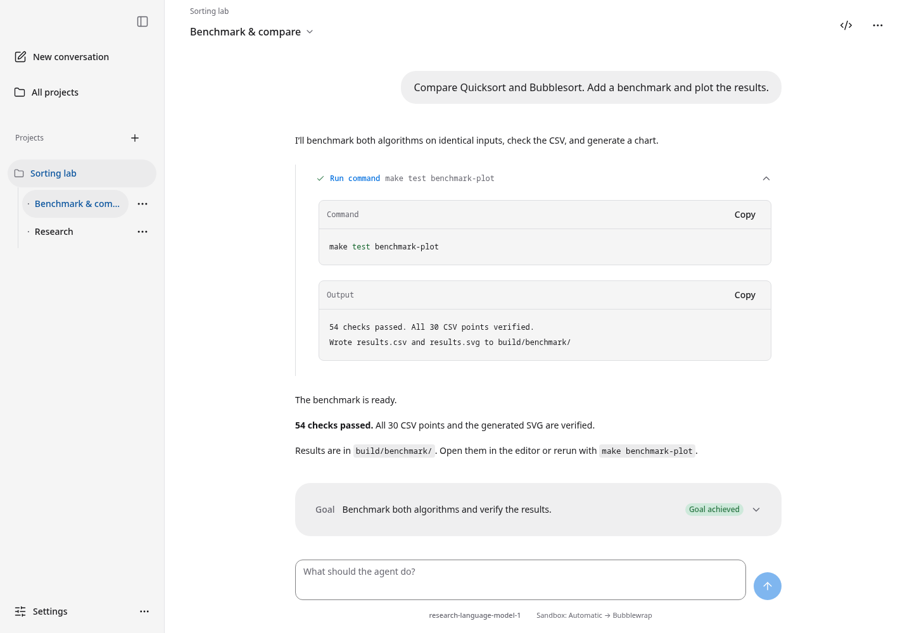

# Zentrale

**AI agents, working on your machines.**

Connect a machine over SSH, choose a model, and give it something to do.
Follow the work in your browser, steer when plans change, or queue the next task
and come back later. Zentrale keeps the conversation, tools, and working environment together.



_Example workspace with demo data._

## Give it some work

- **Hand over a task.** Agents can edit files, run tests, use MCP tools, and start background jobs. Persistent goals keep unfinished work in view.
- **Bring your own models.** Use OpenAI, Anthropic, Gemini, OpenRouter, and other supported providers. Pick separate models for the worker and its reviewer.
- **Use your own compute.** Connect SSH hosts or shared machine pools. Independent jobs can run across multiple machines; prepared hosts can expose GPUs through managed VMs.
- **Jump into the workspace.** Open VS Code or the terminal beside it in the header, sharing the agent's files, Git identity and environment. The fullscreen terminal uses [wterm](https://github.com/vercel-labs/wterm), starts the VM when needed, and keeps it active while connected. Close the terminal to end that shell session and return to the normal VM idle-stop policy. Escape stays in the shell; use **Alt+Shift+T** or **Close** to leave the terminal.
- **See what happened.** Follow commands, diffs, logs, and costs. A separate agent reviews environmental actions and checks proposed goal completion.

## Try it locally

You'll need **Go 1.27.3+**, a **C/C++ toolchain**, **Node.js 22.12+**, and **Make**.
Have an SSH machine and a supported model account ready for your first task.

From a checkout:

```sh
npm ci --prefix frontend
make run
```

Prefer containers? Follow the [Docker setup](docs/getting-started.md#docker).

Open **[localhost:8080](http://localhost:8080)**. Set up your login, connect a model
provider and an SSH machine, then create a project and start a conversation.

Zentrale is in early development. See the [setup guide](docs/getting-started.md)
for remote prerequisites and server configuration.

## Make it yours

[Machines & pools](docs/machines.md) ·
[Sandboxes, GPUs & editor](docs/sandbox-and-editor.md) ·
[Agents & tools](docs/agents.md) ·
[Model & Git connections](docs/integrations.md) ·
[Development](docs/development.md)

Built with Go, React, and DuckDB. The interface speaks English and German.
